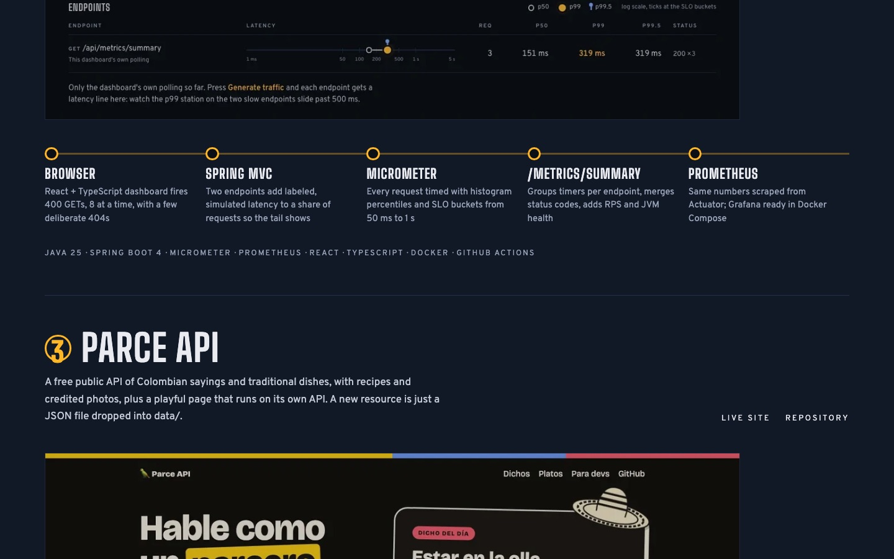
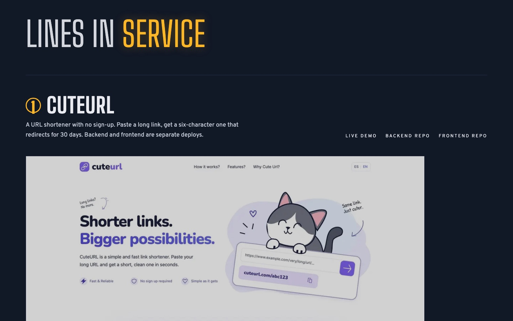
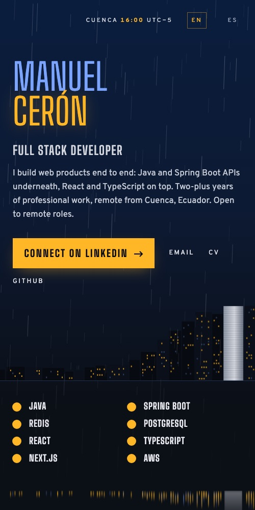

# Manuel Cerón · Portfolio

My work drawn as a night transit network: each project is a numbered line, and the stops are the route a request takes through it. Bilingual (English at `/`, Spanish at `/es`) and prerendered as static pages.

**[manuelceron.vercel.app](https://manuelceron.vercel.app)**



| Projects as transit lines | On a phone |
|---|---|
|  |  |

## Project structure

```
portfolio/
├── app/                    routes only (Next.js App Router)
│   ├── layout.tsx          fonts, metadata, <html>
│   ├── page.tsx            English home  →  <HomePage lang="en" />
│   ├── es/page.tsx         Spanish home  →  <HomePage lang="es" />, with its own metadata
│   └── globals.css         the Night Transit design system (tokens, motion, layout)
├── components/
│   ├── HomePage.tsx        composes the sections for one language
│   ├── sections/           Hero, ProjectLines, MoreProjects, Timetable, Contact
│   ├── ui/                 small reusable pieces: Stops (a transit line), Lit heading, ContactLinks, Clock, Arrow
│   └── scenery/            the seeded SVG skyline, rain and street reflection; RideOnScroll triggers motion in view
├── content/
│   ├── copy.ts             every string on the page, English and Spanish (Spanish is typed from English)
│   └── site.ts             links, email, CV files and the stack, shared by both languages
├── public/                 portrait, project screenshots, CV PDFs
├── DESIGN.md               the design system: palette, type, motion, components
└── PRODUCT.md              who the site is for, what it must and must not say
```

### Principles it follows

- **Content apart from layout.** Copy lives in `content/`, so a new project or a translation is a data change, not a component change.
- **Routes stay thin.** Pages under `app/` only pick a language and metadata; everything they render comes from `components/`.
- **Server components by default.** Only the clock and the scroll observer run in the browser; the rest ships as prerendered HTML.
- **Deterministic art.** The skyline is generated from a fixed seed, so server and client draw the same city and nothing shifts on load.
- **Motion with manners.** Animations pause offscreen and respect `prefers-reduced-motion`.

## Stack

Next.js 16 (App Router), React 19, TypeScript, CSS with design tokens, `next/font` and `next/image`. Deployed on Vercel.

## Run locally

```bash
npm install
npm run dev     # http://localhost:3000
npm run build   # production build
```
